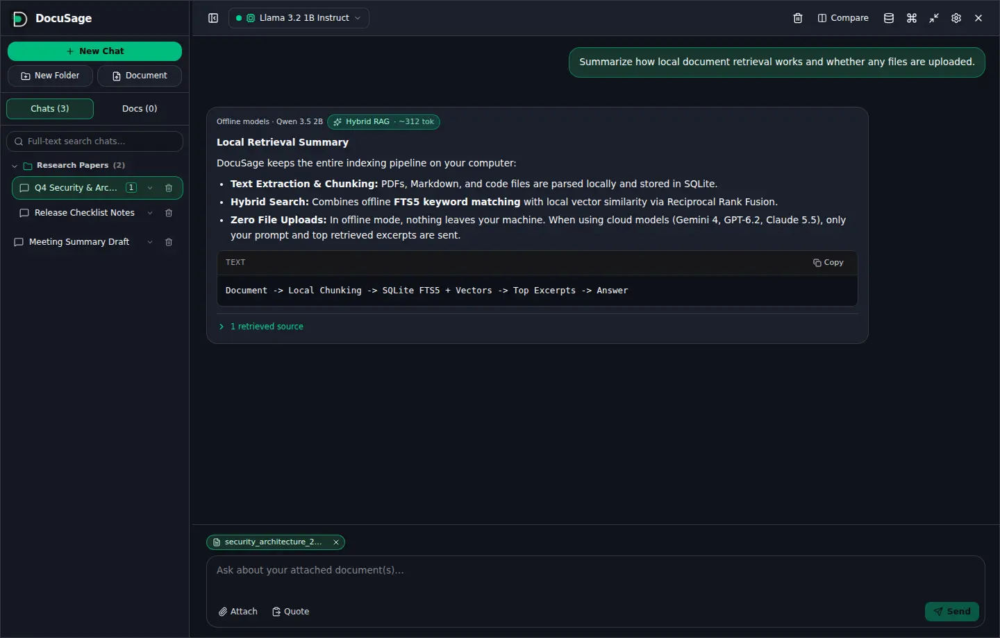
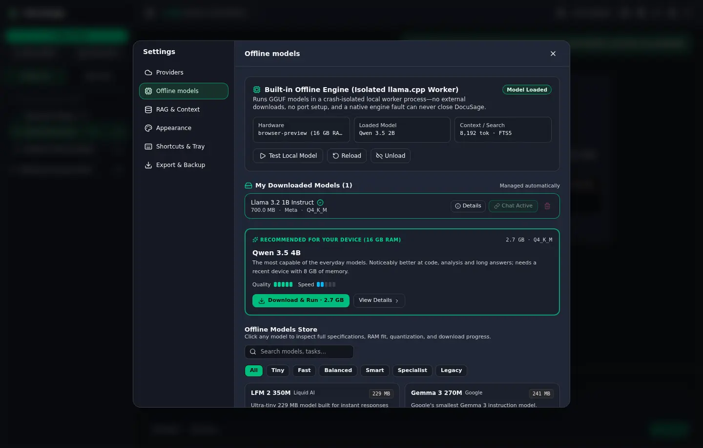

<p align="center">
  
</p>

<h1 align="center">DocuSage Application</h1>

<p align="center">
  <strong>React 19 + TypeScript + Tauri v2 desktop AI for private document chat, offline models, and latest cloud AI.</strong>
</p>

<p align="center">
  <a href="https://waqar-743.github.io/DocuSage/">Website</a>
  &nbsp; | &nbsp;
  <a href="https://github.com/Waqar-743/DocuSage/releases/latest">Download Latest Release</a>
  &nbsp; | &nbsp;
  <a href="https://github.com/Waqar-743/DocuSage">Repository</a>
</p>

## Product Preview

<p align="center">
  
</p>

<p align="center">
  
</p>

DocuSage runs locally on your desktop with a crash-isolated `llama.cpp` offline engine, 36-format local SQLite FTS5 + Vector RAG, latest cloud providers (Gemini 4, OpenAI GPT-6.2, Anthropic Claude 5.5), 8 high-contrast themes, and instant whole-app transparency (`Shift + -` / `Shift + +`).

## Quick Commands

```bash
npm install          # Install frontend dependencies
npm run dev          # Run website preview in browser (?desktop-preview=1 for desktop UI preview)
npm test             # Run Vitest unit & UI regression tests
npm run build        # Build production website
npm run build:desktop # Build desktop-only frontend bundle
npm run tauri dev    # Launch Tauri desktop app in dev mode
npm run tauri build  # Build native desktop installers
```

## Keyboard Shortcuts

| Shortcut | Action |
| --- | --- |
| `Alt + Space` | Toggle Spotlight assistant globally |
| `Ctrl + K` | Open Command Palette |
| `Ctrl + N` | New chat |
| `Ctrl + Shift + V` | Quote clipboard into prompt |
| `Shift + -` / `Shift + +` | Increase / decrease window transparency (`Ctrl + Shift + +/-` while typing) |
| `Ctrl + /` | Open shortcuts modal |
| `Escape` | Close active modal or hide Spotlight |

For the full installation guide, privacy model, and architecture overview, see the [root README](../README.md).
