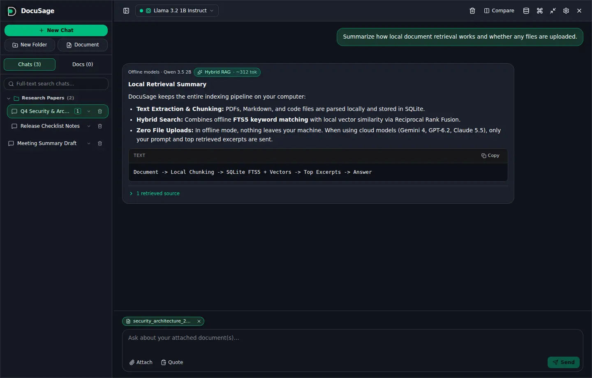
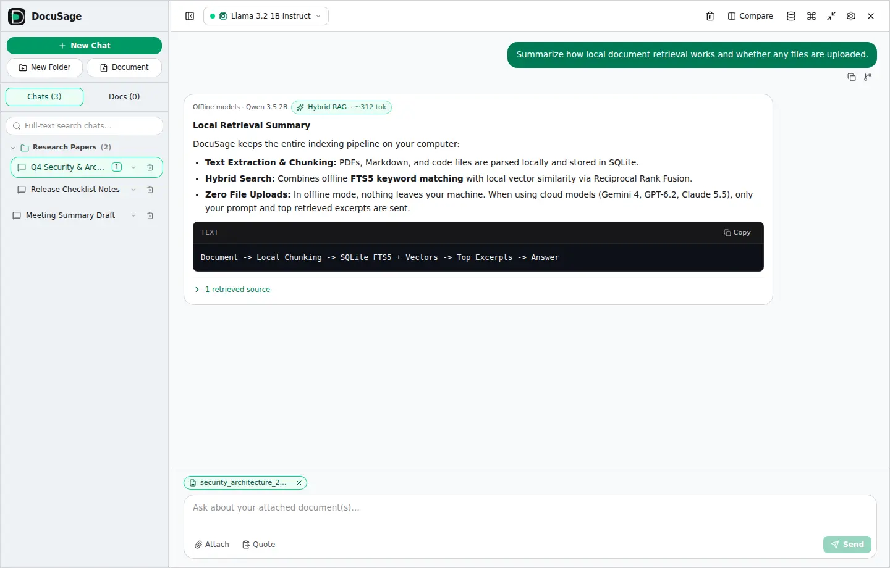
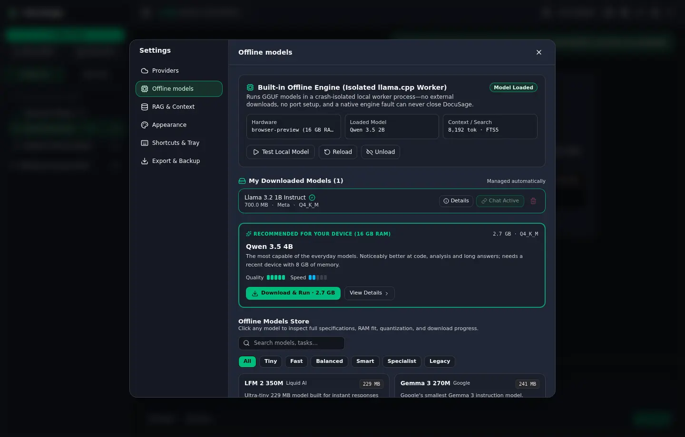
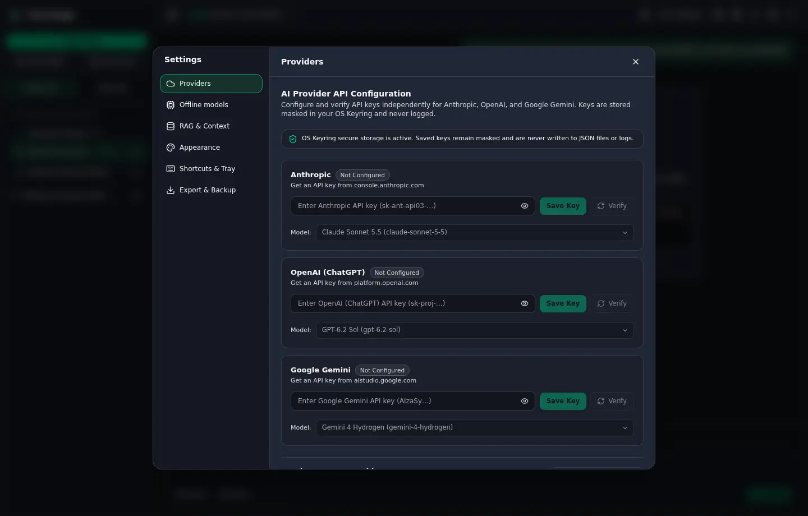
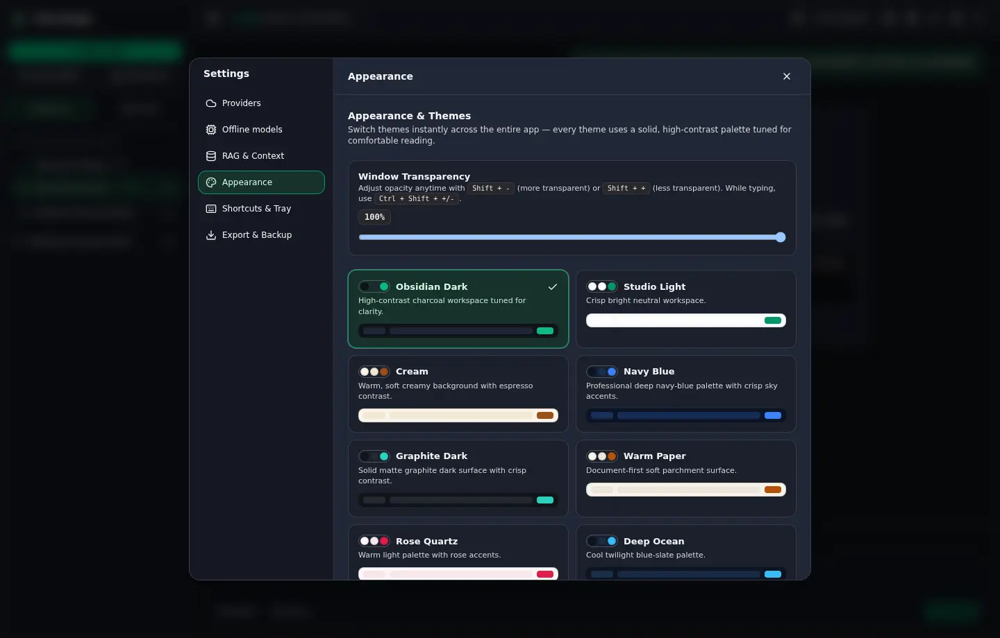
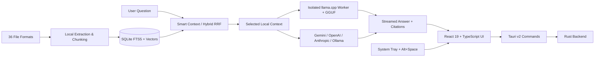

<p align="center">
  
</p>

<h1 align="center">DocuSage</h1>

<p align="center">
  <strong>Private AI document chat — offline models or latest cloud AI, right on your desktop.</strong><br />
  Drop PDFs, notes, or code, search locally with zero uploads, and summon DocuSage anywhere with <code>Alt+Space</code>.
</p>

<p align="center">
  <a href="https://waqar-743.github.io/DocuSage/"><strong>Website</strong></a>
  &nbsp; | &nbsp;
  <a href="https://github.com/Waqar-743/DocuSage/releases/latest"><strong>Download Latest Release</strong></a>
  &nbsp; | &nbsp;
  <a href="DocuSage/docs/releases/v2.0.5.md"><strong>v2.0.5 Release Notes</strong></a>
  &nbsp; | &nbsp;
  <a href="DocuSage/docs/hidden-assistant-mode.md"><strong>Assistant Mode</strong></a>
</p>

<p align="center">
  
  
  
  
</p>

---

## Quick Start (3 Easy Steps)

1. **Install DocuSage:** Download the latest Windows `.exe` or `.msi` installer from [**GitHub Releases**](https://github.com/Waqar-743/DocuSage/releases/latest) and run it.
2. **Choose your AI:**
   - **100% Offline (Free & Private):** Open **Settings -> Offline models** and click **Download & Run** on any model (ultra-fast models start at just **229 MB**).
   - **Cloud AI:** Open **Settings -> Providers** and paste an API key for **Google Gemini (Gemini 4)**, **OpenAI ChatGPT (GPT-6.2)**, or **Anthropic (Claude 5.5)** — stored securely in your OS keyring.
3. **Ask your files:** Click **Document** right under the logo (or drag & drop any file into the window) and start asking questions! Press `Alt+Space` anytime to toggle DocuSage, or `Shift + -` / `Shift + +` to adjust window transparency while reading.

---

## Inside DocuSage

### Workspace (Dark & Light Themes)

<p align="center">
  
</p>

<p align="center">
  
</p>

### Offline Models Store (from 229 MB)

<p align="center">
  
</p>

### Latest Cloud AI Providers & Appearance Themes

<p align="center">
  
</p>

<p align="center">
  
</p>

---

## Key Features

- **1-Click Offline Models:** Download and run compact GGUF models right inside DocuSage — from ultra-fast tiny models (**LFM 2 350M**, **Gemma 3 270M**, **SmolLM2 360M**, **Qwen 3 0.6B**) up to larger reasoning models (**Qwen 3.5 2B / 4B**, **Gemma 4 E2B / E4B**) in a crash-isolated `llama.cpp` worker process.
- **Latest Cloud Models:** Ready-to-use support for **Google Gemini** (`gemini-4-hydrogen`, `gemini-4-carbon`, `gemini-4-neon`, `gemini-4-argon`, `gemini-3.8-flash`), **OpenAI ChatGPT** (`gpt-6.2-sol`, `gpt-6.2-astra`, `gpt-6.1-terra`, `gpt-6-luna`, `gpt-5.2`), **Anthropic Claude** (`claude-sonnet-5-5`, `claude-opus-5-5`, `claude-haiku-5-5`, `claude-fable-5-2`), plus **Ollama**, **LM Studio**, **OpenRouter**, and custom OpenAI-compatible endpoints.
- **36 File Formats & Hybrid Local RAG:** Drag and drop PDFs, Markdown, TXT, CSV, JSON, HTML, and source code (up to 50 MB). Small files use Full Context automatically; large documents use local **SQLite FTS5 + Vector Hybrid Search** with expandable source citations.
- **Instant Transparency & 8 High-Contrast Themes:** Switch between 8 solid themes (Obsidian Dark, Studio Light, Cream, Navy Blue, Graphite Dark, Warm Paper, Rose Quartz, Deep Ocean) and tap `Shift + -` / `Shift + +` to adjust whole-app transparency over any window.
- **Clean, Organized Workspace:** Manage conversations in folders, delete chats in one click from the sidebar or chat header, branch any message, compare 2–4 models side-by-side, and search across all chat history.
- **Cursor-Summoned Spotlight & System Tray:** Launch quietly to the tray and summon DocuSage at your cursor with `Alt+Space`.

---

## Keyboard Shortcuts

| Shortcut | Action |
| --- | --- |
| `Alt + Space` | Summon / hide DocuSage globally (configurable) |
| `Ctrl + K` | Open Command Palette (switch models, themes, or chats) |
| `Ctrl + N` | Start a new chat |
| `Ctrl + Shift + V` | Quote clipboard directly into the prompt |
| `Shift + -` | Increase app transparency (or `Ctrl + Shift + -` while typing) |
| `Shift + +` | Decrease app transparency (or `Ctrl + Shift + +` while typing) |
| `Ctrl + /` | View all keyboard shortcuts |
| `Enter` / `Shift + Enter` | Send message / add a new line |
| `Escape` | Close active modal or hide Spotlight to tray |

---

## Privacy Boundary

- **Offline mode:** Documents, extracted text, SQLite search index, embeddings, prompts, responses, model files, and chat history stay **100% on your computer**.
- **Cloud provider mode:** Document parsing and semantic retrieval still run locally on your machine. Only your active prompt, conversation history, and the top retrieved excerpts are sent to the provider you selected. API keys are stored exclusively in your native OS keyring.

---

## Architecture



---

## Build From Source

### Prerequisites

- Windows 10/11, Linux, or macOS
- [Node.js 22.22.2+ or 24.15+](https://nodejs.org/) and npm
- [Rust stable toolchain](https://www.rust-lang.org/tools/install)
- On Windows: [Microsoft C++ Build Tools](https://visualstudio.microsoft.com/visual-cpp-build-tools/) (Desktop development with C++) and [WebView2 Runtime](https://developer.microsoft.com/microsoft-edge/webview2/)

```bash
git clone https://github.com/Waqar-743/DocuSage.git
cd DocuSage/DocuSage
npm install
npm run tauri dev
```

Build production installers:

```bash
cd DocuSage/DocuSage
npm run tauri build
```

Run tests:

```bash
cd DocuSage/DocuSage
npm test            # Frontend Vitest suite
npm run test:web    # Playwright website + accessibility checks
```

---

## Project Structure

```text
DocuSage/
|-- .github/workflows/
|   |-- pages.yml                 # Website build, Playwright verification & GitHub Pages deploy
|   |-- release.yml               # Tag-triggered Windows installer build & GitHub Release publish
|   `-- build-release.yml         # Portable x64 Windows build, GGUF selftest & installer checks
|-- DocuSage/
|   |-- docs/releases/            # Versioned release notes
|   |-- public/media/             # Website and README screenshots
|   |-- src/
|   |   |-- App.tsx               # Desktop application root
|   |   |-- components/           # Chat, Dashboard, Spotlight, Settings & common UI
|   |   |-- lib/                  # API bridge, model catalog, themes, markdown & migration
|   |   |-- stores/               # Zustand stores (chat, documents, providers, UI)
|   |   `-- MarketingSite.tsx     # Public product website
|   `-- src-tauri/src/            # Rust backend (assistant, providers, SQLite RAG, isolated llama.cpp worker)
`-- README.md
```
